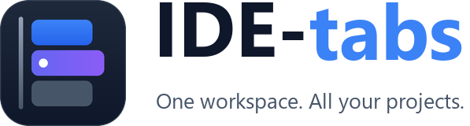
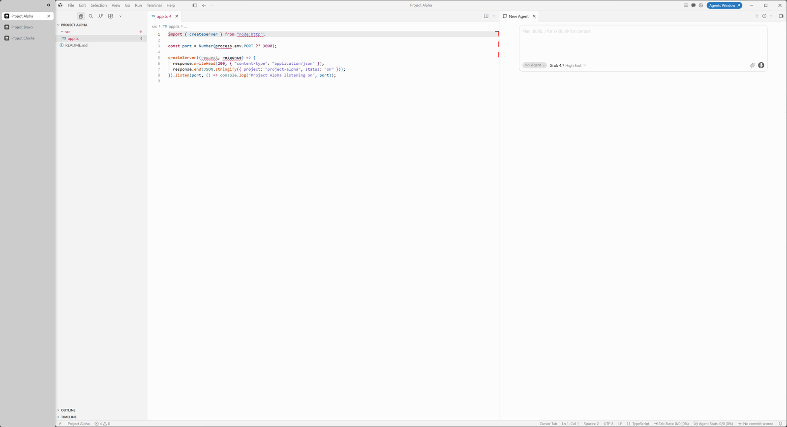
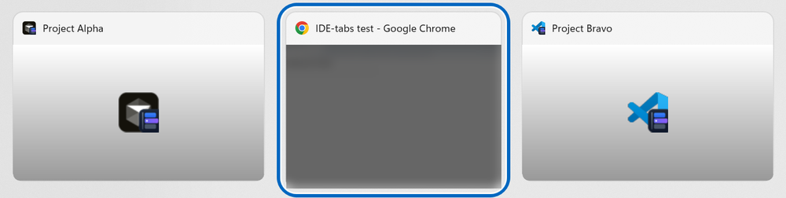
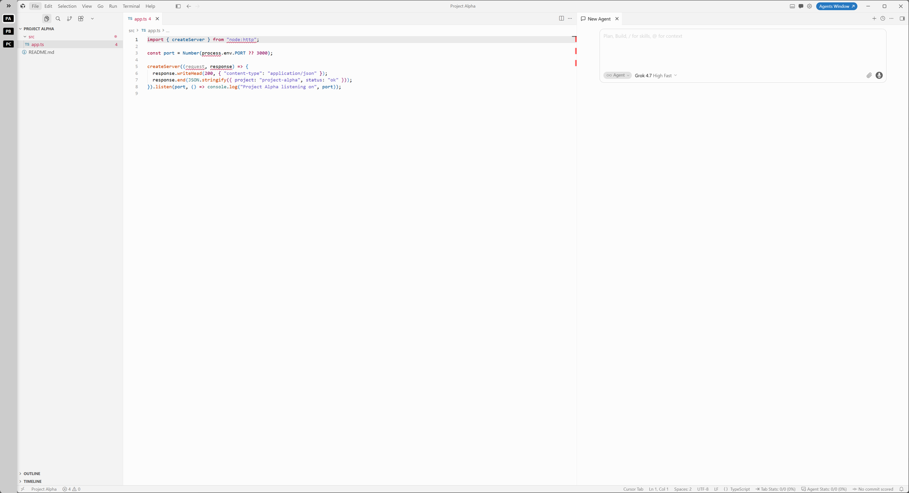
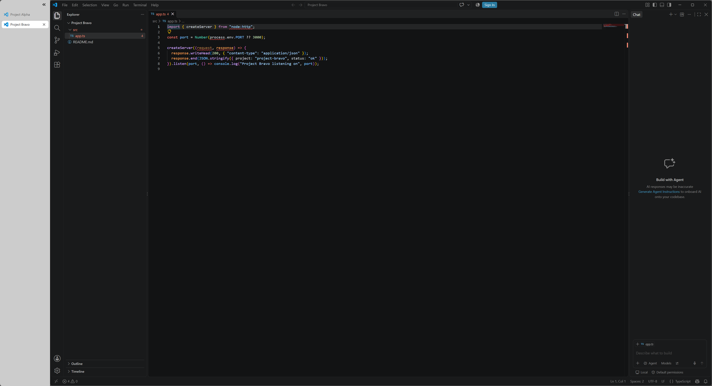
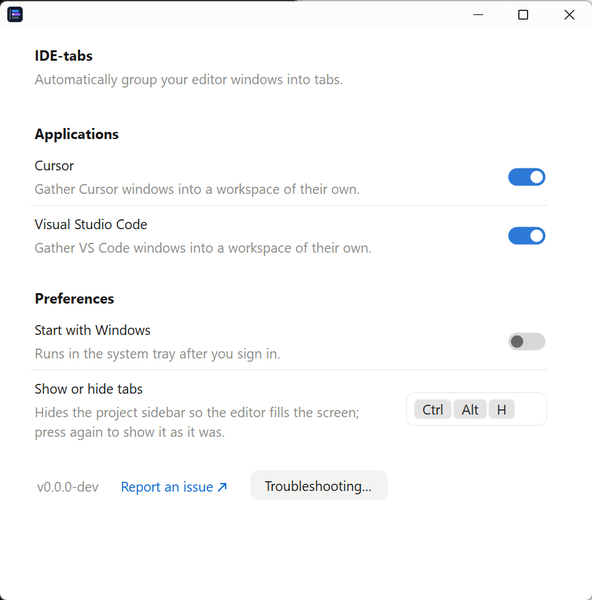

<picture>
  <source media="(prefers-color-scheme: dark)" srcset="docs/assets/logo-dark.png">
  
</picture>

IDE-tabs automatically groups your Cursor and VS Code windows into one Windows workspace
per editor. Your projects appear in a persistent sidebar, the selected project fills the
rest of the screen, and each workspace takes one place in the native Alt+Tab. Each
project keeps its own editor, agent chats and terminals.

> [!IMPORTANT]
> **Early alpha** for **Windows 11**, supporting **Cursor** and **VS Code**. The download
> is not code-signed yet, so Windows SmartScreen warns before the first start.

**[⬇ Download IDE-tabs](https://github.com/Pindaman77/IDE-tabs/releases)** · [Getting started](docs/getting-started.md) · [Known limitations](docs/known-limitations.md)

## What it does

- **One workspace per editor.** Cursor windows join one workspace and VS Code windows
  another, including projects already open and ones you open later. No dragging, no
  setup, and the two editors are never mixed.
- **A project sidebar.** Each project is named after its folder. Click one to bring it
  to the front; the others wait behind it at exactly the same size.
- **One Alt+Tab entry per editor.** Switch to your browser and back with Alt+Tab, and you land in
  the project you were working in, ready to type or paste.
- **Three sidebar sizes.** Expanded with project names, collapsed to project initials
  with the chevron at its top, or hidden with **Ctrl+Alt+H** so Cursor fills the screen.
- **Out of the editors' way.** Ctrl+1–9, Ctrl+Alt+arrows and Shift+scroll stay with
  Cursor and VS Code; IDE-tabs takes only Ctrl+Alt+H.
- **Local only.** No account, no cloud service, nothing sent over the network.

<a href="docs/assets/screenshot-cursor-workspace.png"></a>

**One Alt+Tab entry per editor.** Cursor and VS Code each keep their projects together:



**More room when you need it.** Collapse the sidebar to project initials, or hide it:

<a href="docs/assets/screenshot-collapsed-sidebar.png"></a>

<details>
<summary>VS Code, and the settings</summary>

<a href="docs/assets/screenshot-vscode-workspace.png"></a>



</details>

## Get started

1. Download the latest prerelease from [Releases](https://github.com/Pindaman77/IDE-tabs/releases).
2. Unzip it to a folder of your own, for example `%LocalAppData%\Programs\IDE-tabs`,
   and run `IDE-tabs.exe`. On the SmartScreen warning, choose **More info → Run anyway**.
3. Open your projects in Cursor or VS Code, each in its own window. They join the
   workspace.

IDE-tabs sits in the system tray; click its icon for its one page of settings. The full walkthrough,
including updating and uninstalling, is in [Getting started](docs/getting-started.md).

## Status

| Working now | Planned |
| --- | --- |
| Automatic workspaces for Cursor and VS Code | Installer, and signed downloads |
| Project sidebar: expanded, collapsed, hidden | Windsurf and VSCodium, once tested |
| One native Alt+Tab entry that returns to your project | Live preview in the Alt+Tab entry |
| Fitted layout that survives maximize, snap and drag | Remembering windows taken out of the workspace across restarts |
| Taking a project out by dragging its tab, and back in | |

Read the [known limitations](docs/known-limitations.md) before relying on it for daily
work, and [troubleshooting](docs/troubleshooting.md) if something looks wrong.

## Settings

There is nothing to set up. Clicking the tray icon opens one page where you can turn
Cursor or VS Code off, change the **Ctrl+Alt+H** shortcut that hides and shows the
sidebar, and choose whether IDE-tabs starts with Windows. An editor you turn off stays
off after updates; editors IDE-tabs supports later start on.

## Privacy and security

IDE-tabs works entirely on your PC; see [PRIVACY.md](PRIVACY.md). To report a security
problem, follow [SECURITY.md](SECURITY.md) rather than opening a public issue.

## Development

IDE-tabs is an F# WinForms app on .NET Framework 4.8, with a small C# project for Win32
interop. To build it, install the
[.NET 10.0 SDK](https://dotnet.microsoft.com/en-us/download/dotnet/10.0) and the
[.NET Framework 4.8 Developer Pack](https://dotnet.microsoft.com/en-us/download/dotnet-framework/net48), then:

```powershell
git clone https://github.com/Pindaman77/IDE-tabs
cd IDE-tabs
dotnet build WindowTabs.sln -c Release      # WtProgram\bin\Release\IDE-tabs.exe
```

Read [AGENTS.md](AGENTS.md), [architecture](docs/architecture.md) and
[testing](docs/testing.md) before changing code. The icon and logos are generated from
the [brand concept](docs/assets/brand-concept.png) by `WtProgram/Resources/generate_icons.py`
and `docs/assets/generate_logo.py`.

## Credits and license

IDE-tabs is an open-source Windows IDE workspace manager built on
[WindowTabs](https://github.com/leafOfTree/WindowTabs).

Original WindowTabs project by Maurice Flanagan, with subsequent contributions from the
WindowTabs community. IDE-tabs is released under the [MIT license](LICENSE); the
software it includes is listed in [THIRD_PARTY_NOTICES.md](THIRD_PARTY_NOTICES.md).
